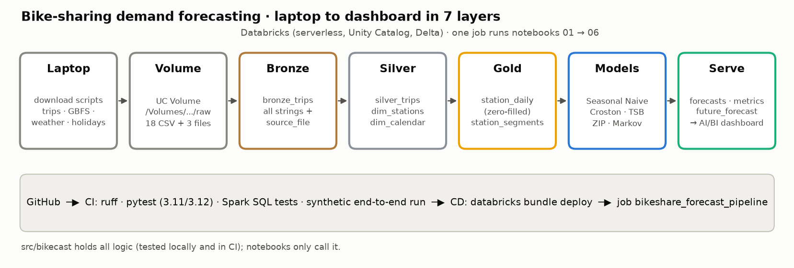
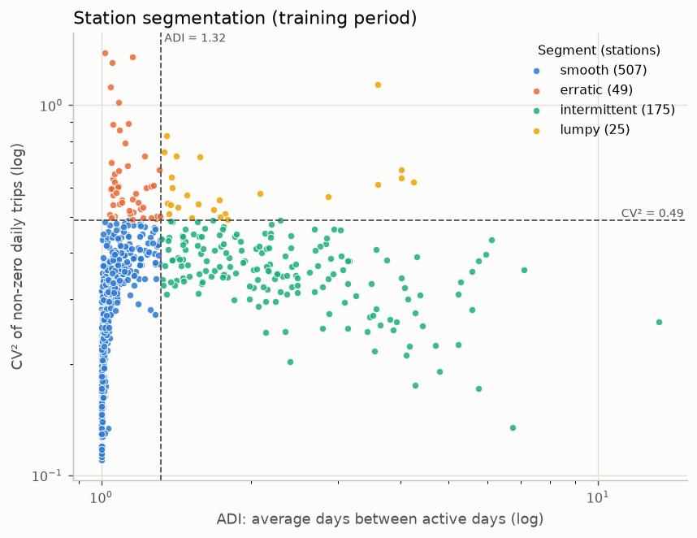
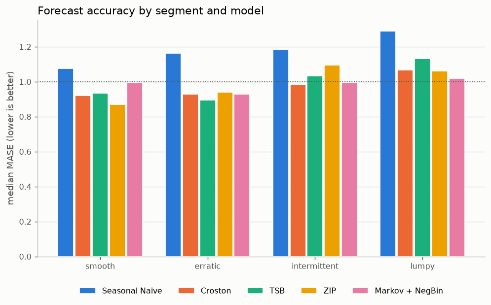

# Forecasting intermittent bike-share demand

[](https://github.com/Triki-Amir/Bike-Sharing-Demand-Forecasting/actions/workflows/ci.yml)
[](https://github.com/Triki-Amir/Bike-Sharing-Demand-Forecasting/actions/workflows/cd.yml)

**On lumpy stations, a Markov-chain + Negative Binomial model cuts median MASE by 21% vs seasonal naive
(1.29 → 1.02); on intermittent stations Croston cuts it by 17% (1.18 → 0.98), with the Markov model a
close second (0.99).**

## Problem

Capital Bikeshare (Washington DC) has hundreds of quiet stations where many days have **zero** rentals.
Generic forecasts (here: a weekly seasonal naive, the "system forecast") copy last week's zeros and spikes and
are wrong on both. This project forecasts daily rentals per station: *whether* a rental happens and
*how many*, and shows that methods built for intermittent demand beat the baseline.
The same process applies to retail items that sell on only a few days.

## Data

| Input | Source | Used for |
|---|---|---|
| Trip history, Jan 2025 – Jun 2026 (18 monthly files) | [Capital Bikeshare system data](https://capitalbikeshare.com/system-data) (`s3.amazonaws.com/capitalbikeshare-data`) | start time and start station of every trip |
| Station list | [GBFS feed](https://gbfs.capitalbikeshare.com/gbfs/2.3/gbfs.json) | name, coordinates, capacity |
| Weather | [Open-Meteo Historical Weather API](https://open-meteo.com/en/docs/historical-weather-api) | daily mean temperature, precipitation |
| Public holidays | [`holidays`](https://pypi.org/project/holidays/) package | US federal + DC holidays |

Trip data is published under the [Capital Bikeshare Data License Agreement](https://capitalbikeshare.com/data-license-agreement).
Raw data is never committed (see `.gitignore`); the scripts in `scripts/` download it.

| Layer | Numbers (real run) |
|---|---|
| Bronze | 9,514,378 rows from 18 files (236k – 705k trips per month) |
| Silver | 7,490,541 valid trips. Removed: 1,933,042 dockless trips without a station, 90,707 with a duration outside 1 min – 24 h, 64 duplicates, 24 outside the period |
| Stations | 873 stations seen in the trips, 851 matched to GBFS |
| Gold | **756 stations × 546 days** (stations active the whole period), **17.0% of station-days have zero trips**, 7,245,782 trips (equal to silver for these stations: no trips lost in the join) |

## Architecture



Monthly trip files and weather go into a Unity Catalog Volume, then into bronze, silver and gold Delta tables.
Models read gold and write forecasts and metrics back to Delta; a dashboard reads those. One Databricks job
(`bikeshare_forecast_pipeline`, defined in [`databricks.yml`](databricks.yml)) runs notebooks 01 → 06 on
serverless compute, so the whole pipeline rebuilds with one click.

All logic lives in [`src/bikecast`](src/bikecast) and is unit-tested; the notebooks only call it.
The Spark SQL of the silver/gold/segmentation layers is in [`src/bikecast/sql.py`](src/bikecast/sql.py) and
is executed in CI on a local Spark session and compared row for row with the pandas implementation
([`pipeline.py`](src/bikecast/pipeline.py)), which also lets the whole project run on a laptop.

```
bikeshare-intermittent-forecasting/
├── .github/workflows/   ci.yml (lint, tests, Spark SQL, synthetic end-to-end) · cd.yml (bundle deploy)
├── databricks.yml       Databricks Asset Bundle: the job, notebooks 01 → 06, serverless
├── scripts/             download_trips.py · fetch_stations.py · fetch_weather.py · make_docs.py
├── notebooks/           01_bronze_ingest · 02_silver_clean · 03_gold_daily · 04_segmentation · 05_backtest · 06_report
├── src/bikecast/        config · sql · pipeline · segmentation · markov · zip_model · metrics · backtest · plots · run_local · synthetic
├── tests/               57 tests: metrics, Markov, segmentation, ZIP, backtest, pipeline, Spark SQL, end-to-end
└── docs/                architecture.png · figures/ · slides.pdf · ai_usage.md
```

## Segmentation

Each station is classified on the **training period only** (up to 2 June 2026) by ADI (average days between
active days) and CV² (squared coefficient of variation of non-zero daily counts), with the Syntetos & Boylan
(2005) thresholds 1.32 and 0.49.

| Segment | Stations | Mean trips/day | Zero days | Share of all trips |
|---|---:|---:|---:|---:|
| smooth | 507 | 24.0 | 4% | 93.3% |
| erratic | 49 | 13.9 | 11% | 5.2% |
| intermittent | 175 | 0.9 | 54% | 1.2% |
| lumpy | 25 | 1.6 | 44% | 0.3% |



Intermittent and lumpy stations are a quarter of the network but 1.5% of the trips. Washington produced enough
quiet stations at daily grain (200), so no extra filter was needed.

## Models

| Model | Library | Idea |
|---|---|---|
| Seasonal Naive (7 days) | statsforecast | baseline: same day last week |
| Croston (classic) | statsforecast | smoothed size ÷ smoothed interval |
| TSB | statsforecast | smoothed probability of a trip × size; adapts when a station dies (α tuned: 0.3 / 0.3) |
| Zero-inflated Poisson | statsmodels | structural zeros + Poisson mean driven by weekend, temperature, rain |
| **Markov + Negative Binomial** | NumPy (own model) | see below (window tuned: 90 days) |

**Markov chain + Negative Binomial** ([`markov.py`](src/bikecast/markov.py)): each day is a state, *active*
(≥ 1 trip) or *inactive*. A 2×2 transition matrix is estimated from the last 90 days with Laplace (+1)
smoothing. Starting from today's state, multiplying by the matrix *k* times gives P(trip on day *k*). The number
of trips on an active day (minus one) is fitted with a Negative Binomial by method of moments (Poisson if not
over-dispersed). Forecast = P(trip) × expected size. It also gives prediction intervals by simulation.

## Results

Backtest: 4 rolling windows of 7 days (cutoffs 2, 9, 16, 23 June 2026; test days 3–30 June 2026). Every model sees
the same training data and is scored on the same 28 days per station. TSB alphas and the Markov window were
chosen on the first two cutoffs only. MASE is scaled by each station's in-sample seasonal-naive MAE (training
data up to 2 June), so it can be averaged across busy and quiet stations; MAPE is unusable with zero days.

**Median MASE** (lower is better, best in bold):

| Segment | Stations | Seasonal Naive | Croston | TSB | ZIP | Markov + NegBin |
|---|---:|---:|---:|---:|---:|---:|
| smooth | 507 | 1.08 | 0.92 | 0.93 | **0.87** | 0.99 |
| erratic | 49 | 1.16 | 0.93 | **0.89** | 0.94 | 0.93 |
| intermittent | 175 | 1.18 | **0.98** | 1.03 | 1.10 | 0.99 |
| lumpy | 25 | 1.29 | 1.07 | 1.13 | 1.06 | **1.02** |

**Mean bias** (positive = over-forecast):

| Segment | Seasonal Naive | Croston | TSB | ZIP | Markov + NegBin |
|---|---:|---:|---:|---:|---:|
| smooth | +17.2% | +43.6% | +16.2% | +77.7% | +14.0% |
| erratic | +8.1% | +5.5% | +4.1% | +31.1% | -0.4% |
| intermittent | +1.7% | -1.3% | +2.2% | +52.2% | -2.0% |
| lumpy | +6.4% | -3.0% | +0.8% | +21.7% | -9.2% |



What the numbers say:

- Every method beats the seasonal naive baseline in every segment. Never use it at quiet stations.
- The Markov model **wins on lumpy stations** and is within 0.01 of the best on intermittent ones, with the
  smallest bias on smooth and erratic stations. It does **not** win on smooth stations, where the weather-aware
  ZIP model is best on MASE.
- ZIP has the best median MASE on smooth stations but a large positive mean bias on quiet ones: June is warm, and
  extrapolating the temperature effect over-forecasts stations that rarely see trips. The ZIP fit converged
  for every station and cutoff (0 fallbacks).
- Mean bias is the average of per-station relative biases, so a few low-volume stations can dominate it
  (e.g. Croston on smooth stations); MASE medians are the primary comparison.
- On zero vs non-zero days, the Markov trip probability (threshold 0.5) is right 68% of the time on
  intermittent stations and 80% on lumpy ones.

More charts: [bias on quiet stations](docs/figures/bias_quiet_stations.png) ·
[station close-up with P(trip)](docs/figures/station_closeup.png) ·
[segment counts and trip share](docs/figures/segment_bars.png) ·
[example series](docs/figures/example_series.png) · [5-slide deck](docs/slides.pdf).

The production output is a next-week forecast (1 – 7 July 2026) for all stations, written to `future_forecast`
(Databricks: computed in parallel with `groupBy().applyInPandas`), with 80% prediction intervals locally.

## Limitations

- Observed weather is used for the test days, as if the weather forecast were perfect (a common, accepted
  simplification that flatters ZIP slightly).
- 18 months only: one full year of seasonality; the test month (June) is a single season.
- Daily grain: intra-day patterns (commute peaks) are ignored; hourly grain is the natural next step.
- Stations that opened or closed during the period are excluded from gold (they would look intermittent
  because they are new).
- Point forecasts are scored; the probabilistic outputs (P(trip), intervals) are not yet scored with a proper
  scoring rule.

## How to run

### On a laptop (Python 3.11 or 3.12)

```bash
python -m venv .venv
# Windows: .venv\Scripts\activate     Mac/Linux: source .venv/bin/activate
pip install -r requirements-dev.txt && pip install -e .

python scripts/download_trips.py      # 18 monthly CSVs -> data/raw/trips (about 1.9 GB unzipped)
python scripts/fetch_stations.py      # data/raw/external/stations.csv
python scripts/fetch_weather.py       # weather_daily.csv + holidays.csv

python -m bikecast.run_local --figures-dir docs/figures   # whole pipeline + backtest, about 3 minutes
python scripts/make_docs.py                               # architecture.png + slides.pdf

pytest                                 # all tests (Spark SQL tests are skipped without PySpark + Java)
ruff check .
```

`python -m bikecast.run_local --synthetic --data-dir data/demo` runs the whole thing on generated data, no
download needed.

### On Databricks (Free Edition works)

1. Create the schema and volume once: `CREATE SCHEMA IF NOT EXISTS workspace.bikeshare; CREATE VOLUME IF NOT EXISTS workspace.bikeshare.raw;`
2. Upload the data to the Volume (UI: *Catalog → workspace → bikeshare → raw → Upload*, folders `trips/` and
   `external/`), or with the CLI:
   ```bash
   databricks fs cp -r data/raw/trips    dbfs:/Volumes/workspace/bikeshare/raw/trips
   databricks fs cp -r data/raw/external dbfs:/Volumes/workspace/bikeshare/raw/external
   ```
3. Deploy and run the job:
   ```bash
   databricks bundle deploy -t dev
   databricks bundle run bikeshare_forecast_pipeline -t dev
   ```
   or open the repo as a *Git folder* and run notebooks 01 → 06 in order.
4. Dashboard: *Dashboards → Create dashboard*, with these datasets:
   ```sql
   SELECT segment, model, percentile(mase, 0.5) AS mase_median FROM workspace.bikeshare.metrics GROUP BY ALL
   SELECT segment, COUNT(*) AS stations FROM workspace.bikeshare.station_segments GROUP BY segment
   SELECT * FROM workspace.bikeshare.forecasts WHERE station_id = :station
   ```

### CI/CD (GitHub Actions)

- **CI** ([`ci.yml`](.github/workflows/ci.yml)), on every push and PR: ruff · pytest on Python 3.11 and 3.12 with
  coverage · the Databricks SQL on a local Spark session (Java 17) compared with pandas · the full pipeline
  (tuning included) on synthetic data, with the results table in the job summary · bundle validation.
- **CD** ([`cd.yml`](.github/workflows/cd.yml)), after CI succeeds on `main` or by hand: `databricks bundle
  deploy`; optionally downloads the raw data on the runner, uploads it to the Volume and runs the job.
  Add the repository secrets `DATABRICKS_HOST` (e.g. `https://dbc-xxxx.cloud.databricks.com`) and
  `DATABRICKS_TOKEN` (a personal access token) to enable it. Without them the deploy steps are skipped
  with a notice.

## Use of AI assistants

See [docs/ai_usage.md](docs/ai_usage.md).

## References

- Syntetos, A. A., & Boylan, J. E. (2005). The accuracy of intermittent demand estimates. *International Journal of Forecasting*, 21(2), 303–314.
- Hyndman, R. J., & Athanasopoulos, G. *Forecasting: Principles and Practice*, 3rd ed. (chapter 5: MASE and accuracy).
- [statsforecast](https://nixtlaverse.nixtla.io/statsforecast/) (Croston, TSB, cross-validation) · [statsmodels ZeroInflatedPoisson](https://www.statsmodels.org/stable/generated/statsmodels.discrete.count_model.ZeroInflatedPoisson.html)
